# Add a game

Add a game the catalog doesn't know, such as your own copy of a multi-disk game, and set it up yourself: group its disks, name it, choose how it starts, and play. Everything here is done from Kairo64's own screens, and all of it is kept.

## 1. Add the disks

Copy the game's disks (D64, G64…) into your games folder (a folder of their own keeps them together), then open the library menu › **Refresh**. A game the catalog doesn't know is listed under its file names, one entry per disk.

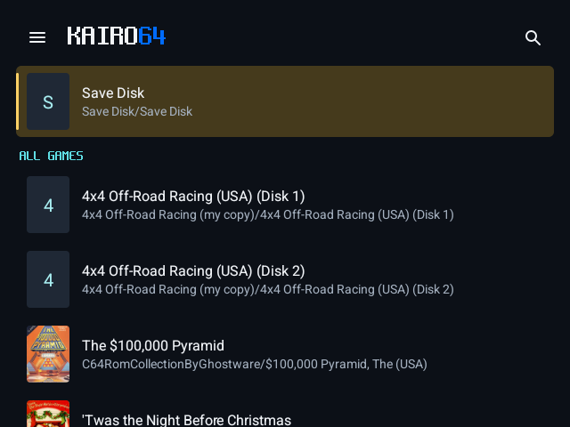

## 2. Group them into one game

Open the disk the game starts from (usually Disk 1) › **Game settings** (on a two-screen device, Game settings is on the second screen). Under **Library**, **Disks** shows the game's disks.

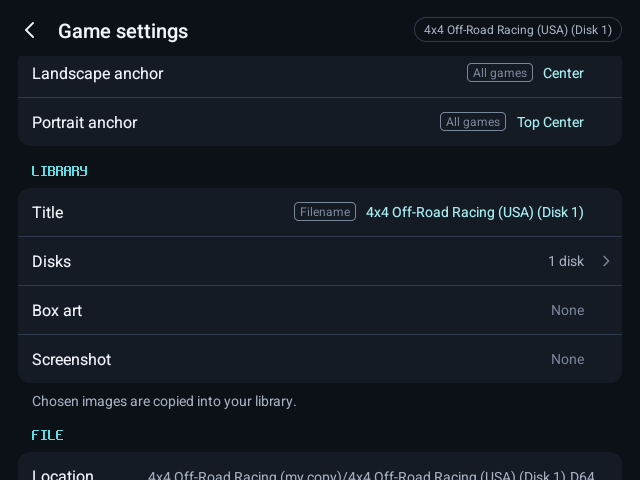

Switch on the game's other disks. They leave the library list and become this game's disks; the row reads "2 disks".

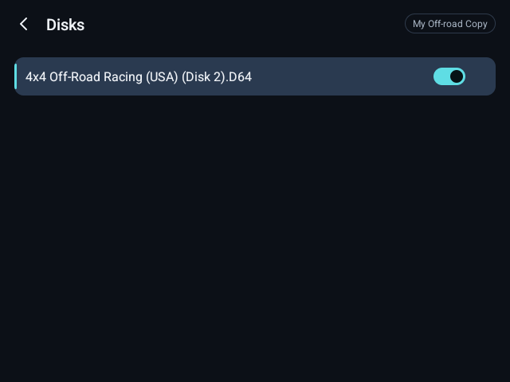

## 3. Name it

Under **Library**, **Title**: type the game's name and save. **Box art** and **Screenshot** take images from your device.

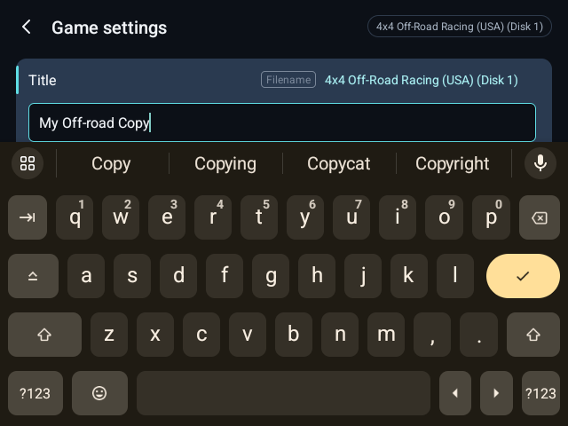

The library now lists it once, under its name.

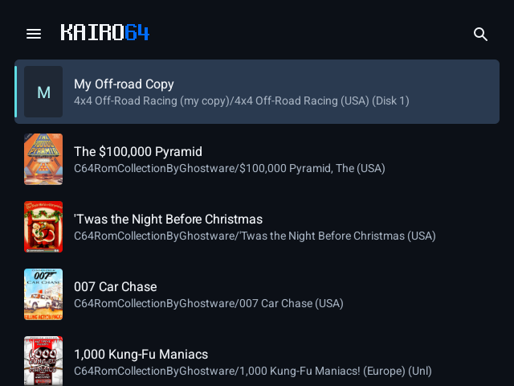

## 4. Choose how it starts

The game starts from the disk you grouped the others on, in Drive 8. Under **Machine**, **Start program** names the program loaded from it (the disk's first program unless you type another name), and **Startup commands** types commands after it starts.

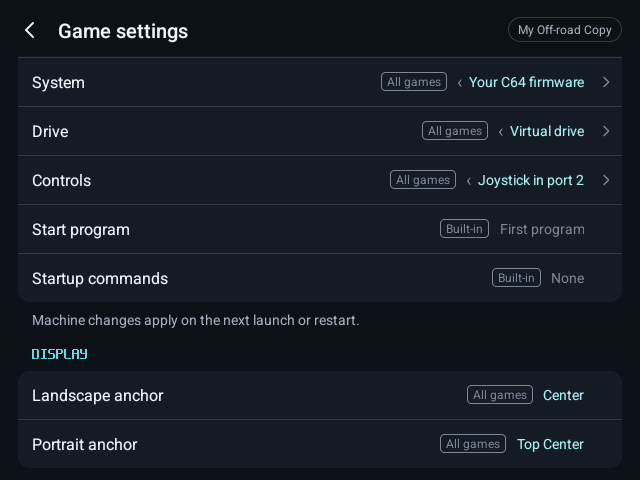

## 5. Firmware

Under **Machine**, **System** chooses the free C64 firmware that comes with Kairo64 or your own C64 firmware.

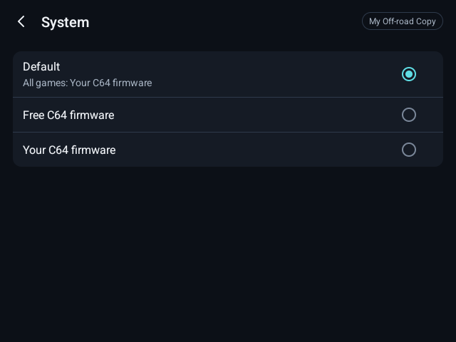

## 6. Configure

Everything else in Game settings (controls, model, drive, display) is kept for this game alone.

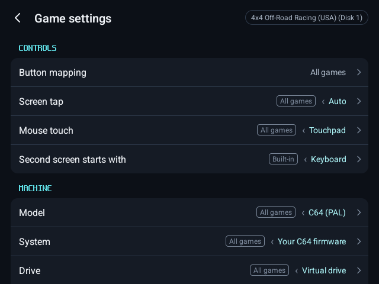

## 7. Play

Press **Play**.

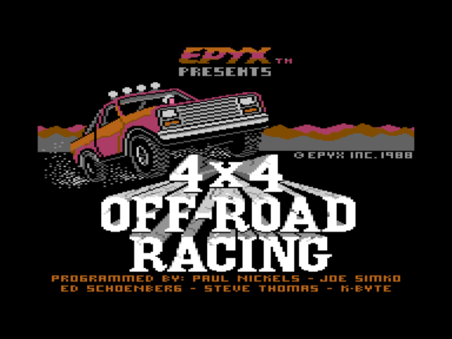

In the menu, **Disks** shows Drive 8 and the other drives.

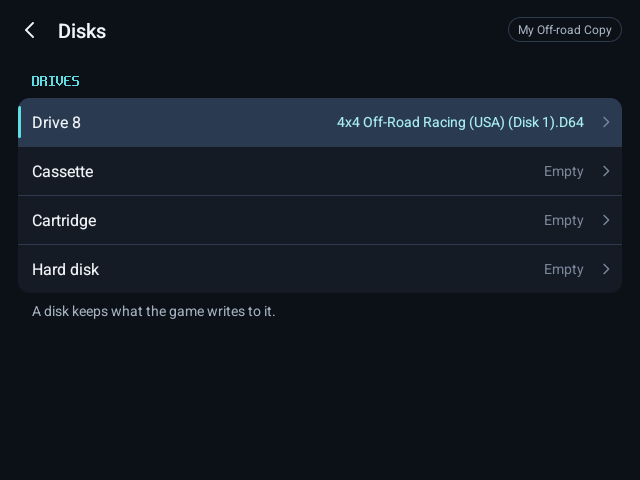

Drive 8 lists the game's disks first, under **This game**, for swapping when it asks.

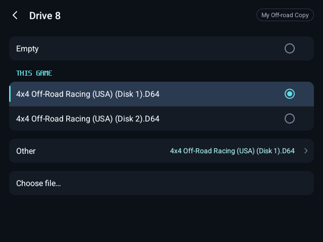

## 8. It is kept

Save your progress with **Save state**, as with any game. What the game writes to its disks is kept too.

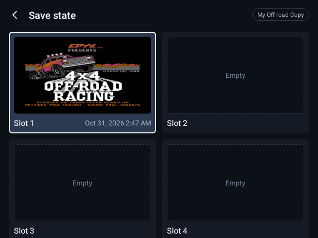

After closing and reopening Kairo64, the game is still one game with its name, disks and settings, and **Load state** brings back your progress.

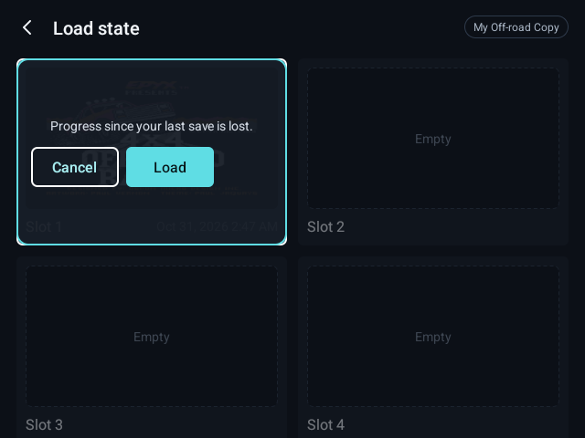
