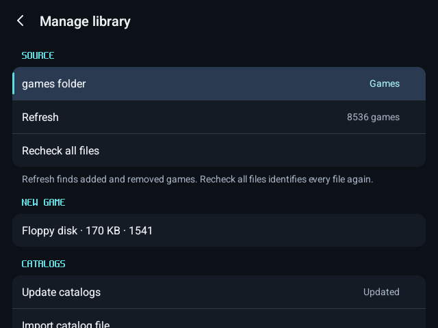
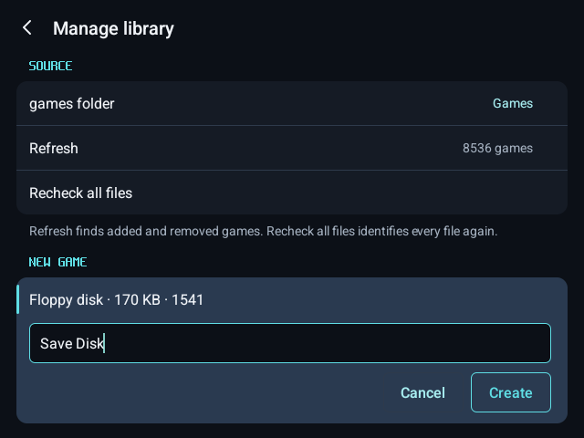
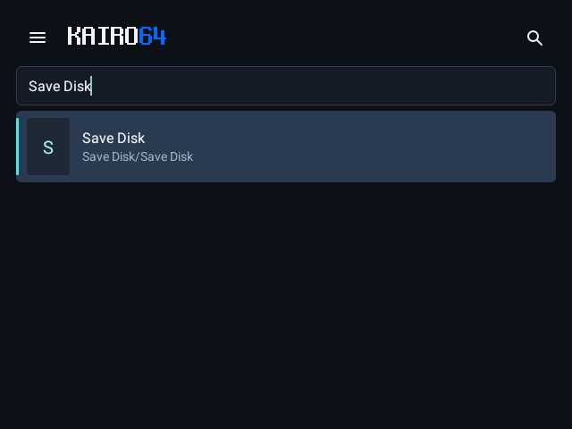
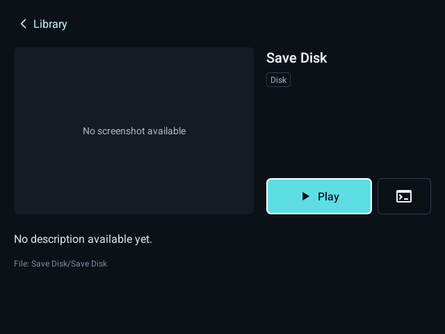
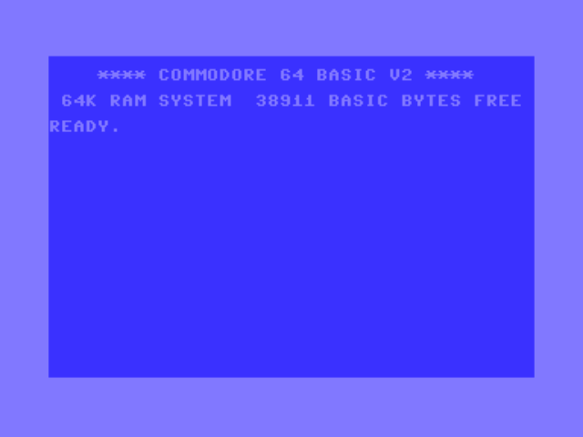
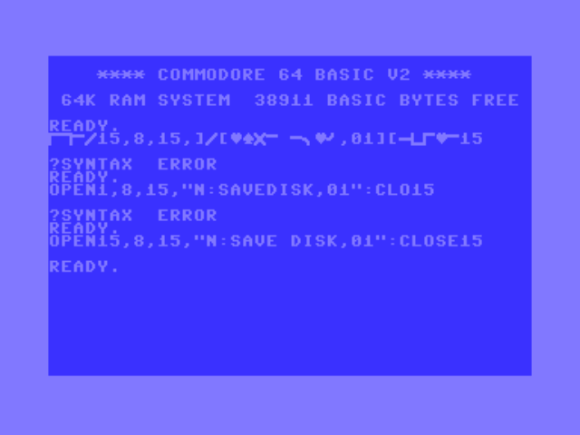
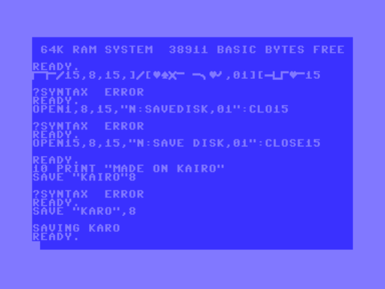
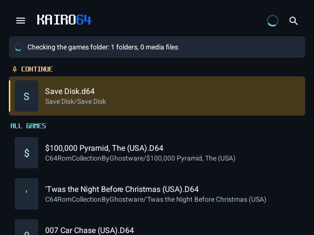
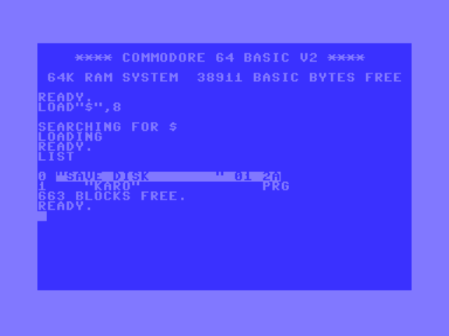

# Create a game

Make a new game on a blank disk: a save disk a game asks for, or a disk of your own programs. Kairo64 makes a blank 1541 floppy; the C64 formats it, as a new floppy was formatted on the real machine. Your game disks can stay wherever they are (for example in Download): the Disks page takes them from anywhere on the device.

## 1. Create the blank disk

Open the library menu › **Manage library**. Under **New game**, choose **Floppy disk · 170 KB · 1541**.



Name the game and press **Create**. Kairo64 makes a folder of that name in your games folder with the blank disk in it.



The new disk is in the library.



## 2. Start at BASIC with the disk in drive 8

Open it and press the command-line button beside **Play**: the C64 starts at READY with the disk in drive 8.





A game that makes its own save disk goes in through the menu › **Disks** › **Choose file…**, from wherever it is; swap the blank disk in when the game asks for it.

## 3. Format it

Type the 1541's NEW command, with the disk's name and ID:

```
OPEN15,8,15,"N:SAVE DISK,01":CLOSE15
```



On the on-screen keyboard, `"` and `:` are on the **?123** page.

## 4. Write to it

Save to it as to any disk, or let the game write its saves to it. Here a program: `SAVE "KARO",8`.



## 5. It keeps what is written

The disk is in your library under the name you gave it.



After closing and reopening Kairo64, `LOAD"$",8` and `LIST` show its name, ID and the saved program.


